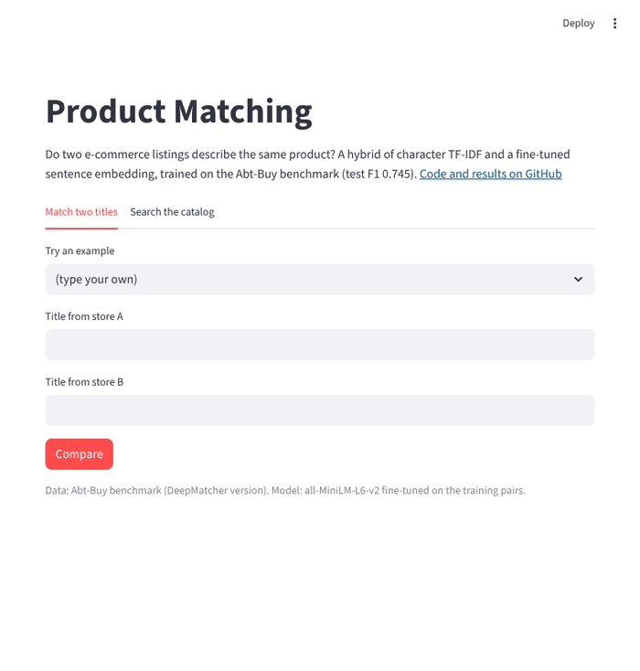
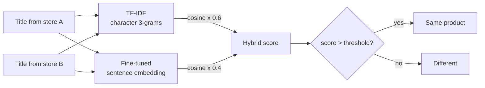

# Product Matching: are these two listings the same product?

Two online stores list the same product with different titles:

```
Abt:  nikon black 13.5 megapixel coolpix digital camera coolpixp6000bk
Buy:  nikon coolpix p6000 13 megapixels digital camera w / 4x wide angle
```

This project decides automatically whether two product titles describe the same product, and serves the model as a REST API (FastAPI, FAISS, Docker). It is the problem behind price comparison sites and catalog deduplication.

**Live demo:** [Streamlit app](https://rabiaozers-item-matching.streamlit.app/): compare two titles or search the catalog in the browser. The fine-tuned model is on the Hugging Face Hub: [rabiaozers/minilm-abtbuy](https://huggingface.co/rabiaozers/minilm-abtbuy).

<!-- Add a short GIF of the demo here:  -->

## How it works



The same hybrid score powers catalog search: each product becomes one vector `[√w · tfidf, √(1−w) · embedding]`, and FAISS returns the nearest ones.

## Results (test set)

| Method | Threshold | Precision | Recall | F1 |
|---|---|---|---|---|
| Always "different" (lazy baseline) | – | 0.000 | 0.000 | 0.000 |
| TF-IDF, character 3-grams | 0.60 | 0.658 | 0.636 | 0.647 |
| Pretrained embedding (all-MiniLM-L6-v2) | 0.85 | 0.500 | 0.442 | 0.469 |
| Fine-tuned embedding | 0.41 | 0.632 | 0.791 | 0.703 |
| **Hybrid: 0.6 · TF-IDF + 0.4 · fine-tuned** | 0.53 | **0.752** | **0.738** | **0.745** |

For reference, Ditto, a strong published model, reports F1 = 0.89 on this dataset.

Thresholds and the hybrid weight are always chosen on the **validation** set; the test set is used once.

Catalog search (one title in, nearest products out, FAISS), recall@k over the 206 true matches in the test set:

| Vectors | recall@1 | recall@5 | recall@10 | recall@20 |
|---|---|---|---|---|
| Fine-tuned embedding | 0.641 | 0.772 | 0.825 | 0.874 |
| TF-IDF | 0.859 | 0.990 | 0.995 | 1.000 |
| **Hybrid (w = 0.6)** | **0.883** | 0.990 | 0.995 | 0.995 |

## Data

[Abt-Buy](https://dbs.uni-leipzig.de/research/projects/benchmark-datasets-for-entity-resolution) in the [DeepMatcher](https://github.com/anhaidgroup/deepmatcher/blob/master/Datasets.md) version: two catalogs (Abt 1,081 products, Buy 1,092) and labelled pairs (train 5,743, valid 1,916, test 1,916).

Only about 11% of the pairs are matches. A model that always says "different" gets 89% accuracy and finds nothing, so this project reports precision, recall and F1 instead of accuracy.

## What I did and what I learned

1. **Baseline first.** Word-level TF-IDF reached F1 0.56 on validation. Character 3-grams raised it to 0.67, because model codes are often written together (`coolpixp6000bk` vs `p6000`).
2. **A pretrained embedding lost to TF-IDF** (F1 0.469). Error analysis showed that almost all of its false alarms were products of the same brand and category that differ only in the model code (`panasonic nnsd797s` vs `nnsd767s`). The model compares meaning, not codes.
3. **Fine-tuning** the embedding model on the labelled training pairs (cosine similarity pushed towards the label, 3 epochs) fixed most of this: F1 0.703, recall 0.44 → 0.79.
4. **Hybrid.** TF-IDF sees characters, the fine-tuned model sees meaning, and they make different mistakes. A weighted average of the two scores gave the best result (F1 0.745). Any weight between 0.2 and 0.6 gave a similar validation F1, so the result is not sensitive to this choice.
5. **Leakage check.** About 90% of test products also appear in training pairs, so a fine-tuned model could memorise products. On test pairs with at least one product never seen in training (128 pairs), the fine-tuned model still beat TF-IDF, by an even larger margin (F1 0.868 vs 0.739; vs 0.634 and 0.612 on seen pairs). It learned to compare codes rather than memorising products. The unseen group is small (128 pairs) and has a much higher match rate (52% vs 8% in the seen group), so its F1 is not directly comparable to the seen group; the comparison that matters is between the two models within each group.
6. **Search revealed a new failure.** In catalog search, the fine-tuned model ranked a *coffee maker* (`delonghi dc50b`) first for a Sony home theater (`davis50b`): it focused on the code and ignored the category. The training pairs were all "similar but different" products, so it never learned to reject obviously unrelated ones. Hybrid vectors (`[√w · tfidf, √(1−w) · embedding]`, whose dot product equals the hybrid score) fixed this: recall@1 0.883.
7. **Experiment: easy negatives.** Adding one random negative pair per training pair improved the model on its own (search recall@1 0.641 → 0.680, match F1 0.703 → 0.717) but not inside the hybrid (0.883 → 0.869, within noise), because TF-IDF already supplies the category signal. The API keeps the original model.

## Known weaknesses and next steps

- Model codes that differ by a single digit (`nnsd797s` vs `nnsd767s`) are still often matched. A dedicated comparison of the alphanumeric model code could help.
- Titles with typos and no model code on one side (`tivo ... ag0100` vs `tvio ... adpator`) are missed. Only product names are used; descriptions could help.
- Hard negative mining: use the model's own wrong search results as training negatives instead of random pairs.
- Store requests and decisions in PostgreSQL (planned with `docker compose`).

## API

`POST /match`: are two titles the same product?

```bash
curl -X POST http://127.0.0.1:8000/match -H "Content-Type: application/json" \
  -d '{"left": "logitech black v220 cordless optical mouse 910000153", "right": "logitech v220 cordless optical mouse 910-000153"}'
# {"score": 0.74, "same_product": true}
```

`POST /search`: the k most similar catalog products for one title (k between 1 and 20).

```bash
curl -X POST http://127.0.0.1:8000/search -H "Content-Type: application/json" \
  -d '{"title": "sony bravia theater black micro system davis50b", "k": 3}'
# [{"id": 949, "name": "sony bravia dav-is50 / b home theater system", "score": 0.59, "same_product": true}, ...]
```

Interactive documentation: `http://127.0.0.1:8000/docs`.

The threshold, hybrid weight and model folder are not hard-coded in the API: `tune_weight.py` chooses them on the validation set and writes `models/hybrid_config.json`, which `app.py` reads at start-up.

## How to run

The data is not stored in this repository (see step 2). The fine-tuned model is on Hugging Face: [rabiaozers/minilm-abtbuy](https://huggingface.co/rabiaozers/minilm-abtbuy).

1. Install: `pip install torch` and `pip install -r requirements.txt`
2. Download [`abt_buy_exp_data.zip`](http://pages.cs.wisc.edu/~anhai/data1/deepmatcher_data/Textual/Abt-Buy/abt_buy_exp_data.zip) and put `tableA.csv`, `tableB.csv`, `train.csv`, `valid.csv`, `test.csv` in `data/deepmatcher/`.
3. Get the fine-tuned model, either
   - download it from Hugging Face: `python -c "from sentence_transformers import SentenceTransformer; SentenceTransformer('rabiaozers/minilm-abtbuy').save('models/minilm-abtbuy')"`, or
   - train it yourself (about 25 minutes on a laptop CPU): `python finetune.py`
4. Choose the hybrid weight and threshold: `python tune_weight.py`
5. Start the API: `uvicorn app:app --reload`, or with Docker:

```bash
docker build -t product-matching .
docker run --rm -p 8000:8000 product-matching
```

Demo locally: `pip install -r streamlit_app/requirements.txt` and `streamlit run streamlit_app/app.py`. The fine-tuned model is uploaded once with `python streamlit_app/upload_model.py`.

Unit tests (no data or model needed): `python -m pytest -q`

## Files

| File | Purpose |
|---|---|
| `data.py` | Load catalogs and pairs; attach product names (pandas merge) |
| `matchers.py` | `TfidfMatcher`, `EmbeddingMatcher`, `HybridMatcher`: same interface, `fit` and `score` |
| `evaluate.py` | Threshold on validation, precision / recall / F1 on test, comparison table |
| `finetune.py` | Fine-tune the embedding model on the training pairs (optional easy negatives) |
| `tune_weight.py` | Choose the hybrid weight and threshold on validation; write the config |
| `search.py` | FAISS catalog search, hybrid vectors, recall@k |
| `app.py` | FastAPI service: `/match`, `/search`, `/health` |
| `streamlit_app/` | Live demo (Streamlit Community Cloud): same models, weight and threshold as the API; loads the model from the Hugging Face Hub |
| `explore.py`, `errors.py`, `unseen_check.py`, `compare_models.py` | Data exploration, error analysis, leakage check, model comparison |
| `tests/` | Unit tests (run by GitHub Actions on every push) |
